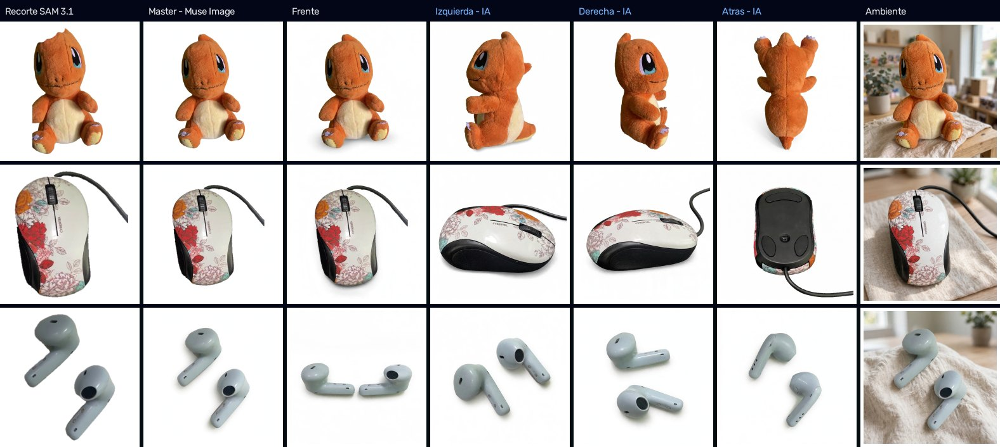
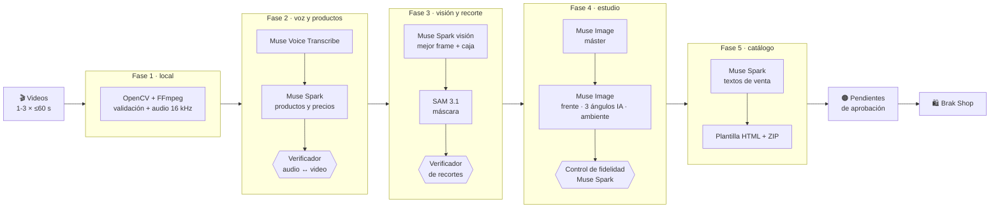

<div align="center">

# Brak Shop · Video-to-Catalog con Meta Muse

**Graba un video mostrando lo que vendes. Brak Shop escucha los precios, encuentra cada objeto, lo recorta, le hace una sesión de fotos de estudio y lo publica en una tienda.**




*Tres productos reales procesados por el pipeline: recorte de **SAM 3.1** → máster de estudio y vistas de **Muse Image** (las marcadas "IA" son ángulos que no se filmaron) → foto de ambiente.*

</div>

---

## Índice

- [Qué hace](#qué-hace)
- [Los modelos de Meta y lo que hace cada uno](#los-modelos-de-meta-y-lo-que-hace-cada-uno)
- [Cómo funciona](#cómo-funciona)
- [Inicio rápido](#inicio-rápido)
- [Usar Brak Shop](#usar-brak-shop)
- [Consejos para grabar los videos](#consejos-para-grabar-los-videos)
- [Costos y tiempos reales](#costos-y-tiempos-reales)
- [API](#api)
- [Estructura del proyecto](#estructura-del-proyecto)
- [Solución de problemas](#solución-de-problemas)
- [Limitaciones conocidas](#limitaciones-conocidas)
- [Recursos](#recursos)

---

## Qué hace

1. **Subes de 1 a 3 videos** (hasta 60 s cada uno) donde muestras objetos y dices su precio: *"este peluche lo vendo a 6 dólares"*, *"esto de acá a 5"*.
2. **Meta Muse procesa todo por detrás**, en 5 fases encadenadas y con 7 pasos de modelos.
3. **Los productos llegan a una bandeja de aprobación**, donde ves el frame original, el recorte, las fotos de estudio, el tipo de mención y la calidad, y editas nombre, precio o estado.
4. **Con un clic se publican en Brak Shop:** una tienda con filtros, buscador, vistas por producto, carrito y monitor de tokens en vivo.

Todo usa la **API real de Meta** (`api.meta.ai/v1`): no hay resultados escritos a mano. Cada fase tiene un **agente verificador** que revisa el trabajo de la anterior y lo corrige solo, con un número acotado de llamadas.

---

## Los modelos de Meta y lo que hace cada uno

| Paso | Modelo | Qué hace en Brak Shop |
|:---:|---|---|
| 1 | **OpenCV + FFmpeg** (local, 0 tokens) | Valida los videos (duración, oscuridad, desenfoque) y extrae el audio a 16 kHz |
| 2 | **`muse-voice-transcribe-1.0`** | Transcribe la voz del vendedor en turnos con tiempos |
| 3 | **`muse-spark-1.3`** | Ve el video y lee la transcripción: detecta cada producto, su precio (incluidas las correcciones en vivo), su estado y si fue nombrado (`EXPLICIT`) o solo señalado (`DEICTIC`, *"esto de acá"*). Luego **verifica audio ↔ video** y recupera objetos que se mostraron pero el transcriptor no captó |
| 4 | **`muse-spark-1.3` · visión** | En un collage 1×3 de los mejores frames, elige el fotograma ideal, nombra el producto, puntúa la calidad y lo ubica con una caja |
| 5 | **`sam-3.1`** | Recorta el producto con precisión de píxel. Un verificador revisa cada recorte y repara los incompletos: une piezas de un par, agrega partes faltantes o cambia de fotograma |
| 6 | **`muse-image-1.0`** | Crea el **máster de estudio** (completa lo cortado por el encuadre o tapado por la mano) y, desde él, el **frente**, **3 ángulos deducidos por IA** (izquierda, derecha, atrás) y una **foto de ambiente**. Spark controla la **fidelidad** de cada imagen |
| 7 | **`muse-spark-1.3` · textos** | Escribe título, descripción, puntos destacados, categorías y etiquetas, y arma el catálogo |

> **Muse Glimmer** y **Muse Code** aparecen en la documentación de Meta pero no están disponibles en la API: sus roles los cumple `muse-spark-1.3` (visión y redacción).

---

## Cómo funciona



**Principios del diseño:**

- **Agentes que se revisan, con límite:** cada verificador hace como máximo 1–2 llamadas extra y solo cuando detecta un problema. No hay conversaciones abiertas entre agentes.
- **Honestidad antes que maquillaje:** si una toma es demasiado borrosa, no se inventan fotos y se muestra la foto real. Las vistas que no se filmaron van marcadas como **IA**. Un objeto sin precio dicho queda como **"Consultar precio"**.
- **Caché MD5 en todo:** repetir un video ya procesado cuesta ~US$0 y tarda ~1 min.
- **Números reales:** los tokens vienen del campo `usage` de cada respuesta de la API y las imágenes se cuentan una por una.
- **Robustez ante la nube:** la espera a Meta se ajusta al tamaño de cada llamada y el reintento espera el doble. Si una petición se traba, se recupera sola y la interfaz lo muestra en vivo.

Más detalle en **[docs/ARCHITECTURE.md](docs/ARCHITECTURE.md)**.

---

## Inicio rápido

### Requisitos

- **Python 3.11**
- **FFmpeg** en el `PATH` ([descarga](https://ffmpeg.org/download.html))
- Una **clave de la Meta Model API** ([dev.meta.ai](https://dev.meta.ai/docs/models.md))
- Conexión a internet: los modelos y los estilos (Tailwind CDN) se cargan en línea

### Instalación

```bash
git clone git@github.com:marco-torres-ai/brak.git
cd brak
python -m venv .venv
# Windows: .venv\Scripts\activate   ·   macOS/Linux: source .venv/bin/activate
pip install -r backend/requirements.txt
```

### Configuración

```bash
cp .env.example .env      # Windows: copy .env.example .env
```

Abre `.env` y pega tu clave en `META_MUSE_API_KEY`. Las demás variables tienen valores por defecto que funcionan; todas están explicadas en [`.env.example`](.env.example).

> 🔒 `.env` está en `.gitignore`. La clave vive solo en el backend y nunca se envía al navegador.

### Ejecutar

```bash
uvicorn backend.main:app --port 8000
```

Abre **http://localhost:8000**.

> Para desarrollar puedes agregar `--reload`. **El día de la demo, no lo uses:** cualquier archivo que cambie (incluida la sincronización de OneDrive o Dropbox) reinicia el servidor y corta el proceso en curso.

---

## Usar Brak Shop

| Sección | Qué encuentras |
|---|---|
| **Tienda Activa** | Los productos aprobados: filtros por categoría, buscador, orden por precio, selector de vistas, vista rápida, carrito con totales por moneda. Se guardan en el navegador (`localStorage`). La primera vez carga como ejemplo los productos de la última sesión procesada |
| **＋ Agregar Productos con Video (Muse AI)** | Arrastras los videos y pulsas **Procesar**. El stepper avanza modelo por modelo, con la última acción del backend, contadores en vivo de tokens, imágenes y caché, y un aviso si Meta tarda más de lo normal. Si una fase falla, **"Reintentar desde este paso"** continúa sin repetir lo anterior |
| **Pendientes de Aprobación** | Comparas mejor frame, recorte SAM y fotos de estudio; ves si la mención fue `EXPLICIT` o `DEICTIC` y la calidad del frame; editas nombre, precio o estado; **✅ Aceptar y Publicar**, **🗑️ Rechazar** o **✅ Aceptar Todos** |
| **📊 Monitor** | Las trazas del `TokenTracker`: tokens por modelo, llamadas a la API, aciertos de caché e imágenes cobradas |
| **Agentes** | Configuras los prompts de los 13 agentes. Puedes sumar **instrucciones adicionales** (por ejemplo, "tono juvenil" en los textos o "luz cálida" en las fotos de ambiente) o reescribirlos completos en **modo experto**. Los cambios se guardan en **perfiles** con nombre: creas uno con "＋ Nuevo perfil" (vacío o como copia del actual), lo renombras o lo eliminas. Los verificadores están en "Avanzado". Con el perfil "Original de Meta Muse" todo funciona exactamente como siempre. Ver [docs/API.md](docs/API.md#prompts-de-los-agentes-v02) |

Para empezar de cero en una demo, borra los datos del sitio: **F12 → Application → Local Storage**.

---

## Consejos para grabar los videos

- **Un objeto a la vez:** sostenlo quieto **2–3 segundos** mientras dices *"este [nombre] lo vendo a X dólares"*.
- **Que entre completo en el encuadre.** Si sale cortado, la IA lo completa, pero es donde más tiene que deducir.
- **Buena luz y cámara estable.** Una toma movida se marca como "toma insuficiente" y no se le generan fotos.
- **Para lucir a Spark,** incluye un **"esto de acá lo vendo a 5"** sin nombrarlo: el modelo lo identifica mirando el video.
- **Para una demo en vivo:** procesa antes tus videos principales (al repetirlos salen de la caché en ~1 min) y muestra en vivo uno corto, de 2–3 productos (~3–4 min).

---

## Costos y tiempos reales

Medidos en las pruebas del proyecto, con la API real:

| Caso | Tiempo | Costo |
|---|---|---|
| 1 video, 3 productos | ~4 min | US$0.13 (13 imágenes) + ~26k tokens |
| 2 videos, 7 productos | ~6–7 min | ~US$0.44 + ~45k tokens |
| 3 videos, 15 productos | ~10–12 min | US$0.87 (87 imágenes) + ~140k tokens |
| Repetir cualquiera de los anteriores | ~1 min | ~US$0 (caché) |

- La fase más larga es la 4 (~30 s por producto): cada imagen de `muse-image-1.0` tarda 11–35 s, y se generan 6 a la vez.
- `muse-image-1.0` cobra **US$0.01 por imagen** (no por token). `sam-3.1` cobra por imagen procesada y no reporta tokens. Precios oficiales: [Pricing & rate limits](https://dev.meta.ai/docs/pricing-rate-limits).

---

## API

El backend es una API HTTP + JSON que cualquier frontend puede consumir (CORS abierto).

| Método | Ruta | Para qué |
|---|---|---|
| `POST` | `/api/v1/phase1/preprocess` | Sube 1–3 videos (`multipart`, campo `files`) → crea la sesión |
| `POST` | `/api/v1/phase2/semantic` | Voz + productos + verificación audio ↔ video |
| `POST` | `/api/v1/phase3/vision-sam` | Mejor frame + recorte SAM + verificación |
| `POST` | `/api/v1/phase4/studio` | Máster, vistas, ambiente + control de fidelidad |
| `POST` | `/api/v1/phase5/codegen` | Textos de venta + catálogo |
| `POST` | `/api/v1/pipeline/run-all` | Fases 2 → 5 seguidas |
| `GET` | `/api/v1/progress?session_id=` | Progreso en vivo de la fase en curso |
| `GET` | `/api/v1/session/current` | Estado completo de la última sesión |
| `GET` | `/api/v1/phase5/catalog-preview?session_id=` | Catálogo HTML |
| `GET` | `/api/v1/phase5/catalog-download?session_id=` | Catálogo en ZIP (se abre sin servidor) |

Referencia completa, con ejemplos y la forma de construir las URLs de las imágenes: **[docs/API.md](docs/API.md)**.

---

## Estructura del proyecto

```text
brak/
├── backend/
│   ├── main.py                    # FastAPI: endpoints de las fases, progreso y catálogo
│   ├── requirements.txt
│   ├── core/
│   │   ├── config.py              # Variables de .env y valores por defecto
│   │   ├── muse_api.py            # Cliente HTTP de la Meta Model API (reintentos, JSON Schema, usage)
│   │   ├── muse_client.py         # Transcripción y análisis semántico (Fase 2) con caché MD5
│   │   ├── progress.py            # Progreso en vivo de la fase en curso
│   │   └── token_tracker.py       # Auditoría de tokens y trazas [MUSE-TRACE]
│   └── services/
│       ├── phase1_preprocess.py   # Validación de video y audio 16 kHz (local)
│       ├── phase2_semantic.py     # Orquestación de la Fase 2
│       ├── phase2_verify.py       # Verificador audio ↔ video
│       ├── phase3_vision_sam.py   # Ventana, frames, collage, Spark visión y SAM 3.1
│       ├── phase3_verify.py       # Verificador y reparación de recortes
│       ├── phase4_studio.py       # Muse Image: máster, vistas, ambiente y control de fidelidad
│       └── phase5_codegen.py      # Textos de venta, plantilla del catálogo y ZIP
├── frontend/
│   └── index.html                 # Brak Shop (Tailwind + JavaScript, sin compilación)
├── docs/
│   ├── ARCHITECTURE.md            # Cómo funciona por dentro y por qué
│   ├── API.md                     # Referencia de endpoints
│   └── assets/                    # Imágenes de la documentación
├── storage/                       # Sesiones, imágenes y caché (no se versiona)
├── .env.example                   # Plantilla de configuración
├── AGENT_CONTEXT.md               # Estado y contratos del proyecto (para agentes de desarrollo)
└── CHANGELOG_AND_TOKENS.md        # Bitácora de cambios con costos y resultados medidos
```

---

## Solución de problemas

| Síntoma | Causa probable | Qué hacer |
|---|---|---|
| `Falta META_MUSE_API_KEY` | No existe `.env` o está vacío | Copia `.env.example` a `.env` y pega la clave |
| La Fase 1 rechaza un video | Supera los 60 s, está en negro o el códec no es compatible | Recórtalo o expórtalo como MP4 (H.264) |
| "No se detectaron productos" | No se dijo un precio o el audio está muy bajo | Di *"vendo esto a X dólares"* con cada objeto |
| Aviso ámbar "Meta no respondió…" | Una petición quedó trabada del lado de Meta | Nada: el sistema reintenta solo con más tiempo |
| Un producto sale como "Foto real del video" | La toma estaba movida o borrosa | Graba de nuevo ese objeto, quieto y con luz |
| `content_policy_violation` en el registro | Marcas o personajes en el nombre (Disney, Marvel…) | Nada: se reintenta sin el nombre |
| El servidor se reinicia a mitad del proceso | Se está usando `--reload` | Arráncalo sin `--reload` |
| La página no tiene estilos | No hay conexión a internet (Tailwind CDN) | Conéctate a internet |

---

## Limitaciones conocidas

Es una **demo de hackathon** pensada para una persona y para lucir los modelos de Meta:

- **Un usuario a la vez:** hay una sola "sesión actual" y un solo registro de progreso. No tiene login. El CORS está abierto.
- **`/api/health` muestra parte de la clave** (enmascarada): úsalo solo en local.
- **Peticiones largas:** cada fase responde al terminar (la 4 puede tardar varios minutos). No hay cola de trabajos.
- **Aprobaciones solo en el navegador:** se guardan en `localStorage` y no se sincronizan con el catálogo del backend.
- **Los verificadores también son IA:** reducen mucho los errores, pero pueden equivocarse. La revisión final en **Pendientes** existe para eso.
- **Las vistas IA son deducidas:** izquierda, derecha y atrás muestran cómo *probablemente* se ve el producto.
- **Probado en español,** con objetos de una habitación, y USD por defecto cuando no se dice la moneda.
- **El `CHANGELOG` conserva entradas de una versión simulada anterior (v1.x).** Las versiones reales empiezan en la v2.0.0.

---

## Recursos

**Meta Model API**
- [Modelos disponibles](https://dev.meta.ai/docs/models.md) · [Precios y límites](https://dev.meta.ai/docs/pricing-rate-limits)
- [Speech-to-text (Muse Voice Transcribe)](https://dev.meta.ai/docs/speech-to-text)
- [Comprensión de video](https://dev.meta.ai/docs/video-understanding) · [Comprensión de imágenes](https://dev.meta.ai/docs/image-understanding)
- [Salida estructurada (JSON Schema)](https://dev.meta.ai/docs/structured-output) · [Razonamiento (`reasoning_effort`)](https://dev.meta.ai/docs/reasoning)
- [Segmentación con SAM 3.1](https://dev.meta.ai/docs/media-segmentation) · [Prompts de texto, caja y punto](https://dev.meta.ai/docs/sam/segmenting) · [Leer la salida de SAM](https://dev.meta.ai/docs/sam/reading-segmentation) · [Librerías cliente](https://dev.meta.ai/docs/sam/client-libraries)
- [Generación y edición de imágenes (Muse Image)](https://dev.meta.ai/docs/image-generation)
- [`meta-sam-parser` en PyPI](https://pypi.org/project/meta-sam-parser/): parser oficial de la salida de SAM

**Stack**
- [FastAPI](https://fastapi.tiangolo.com/) · [Uvicorn](https://www.uvicorn.org/) · [OpenCV](https://opencv.org/) · [FFmpeg](https://ffmpeg.org/) · [Tailwind CSS](https://tailwindcss.com/) · [Mermaid](https://mermaid.js.org/)

**Documentación del proyecto**
- [docs/ARCHITECTURE.md](docs/ARCHITECTURE.md): fases, verificadores, caché, robustez y lecciones aprendidas
- [docs/API.md](docs/API.md): endpoints, ejemplos y contratos JSON
- [CHANGELOG_AND_TOKENS.md](CHANGELOG_AND_TOKENS.md): cada cambio con sus resultados y costos medidos

---

<div align="center">

Hecho para una hackathon con la **Meta Model API** · Muse Voice Transcribe · Muse Spark · SAM 3.1 · Muse Image

</div>
