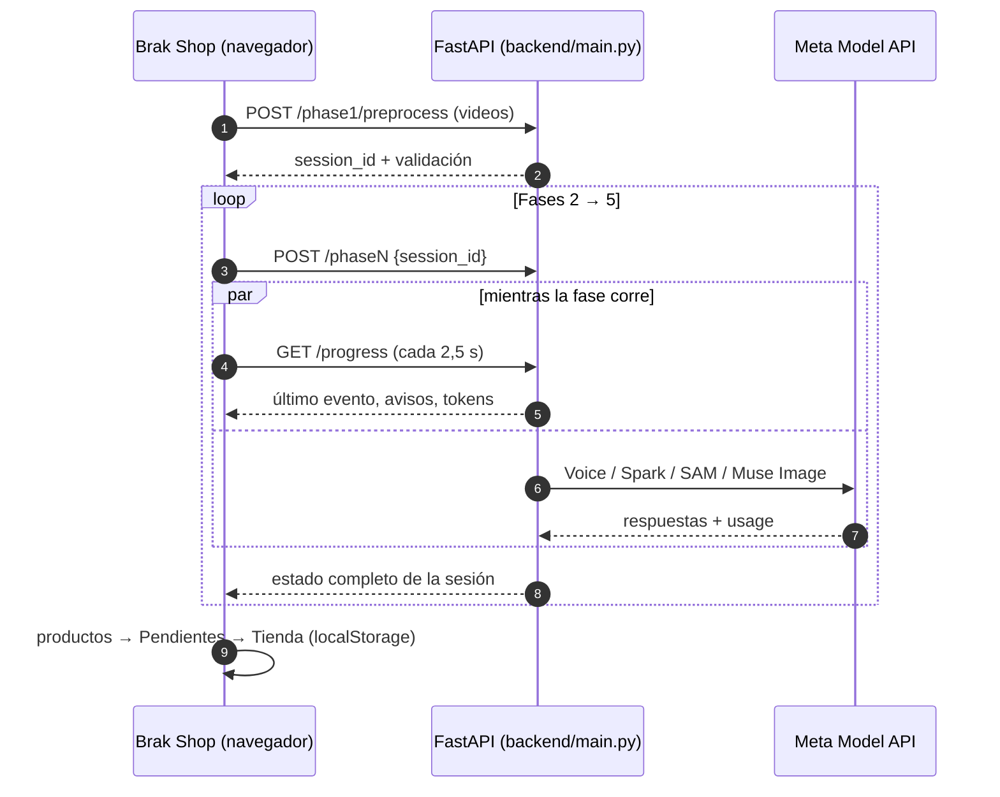
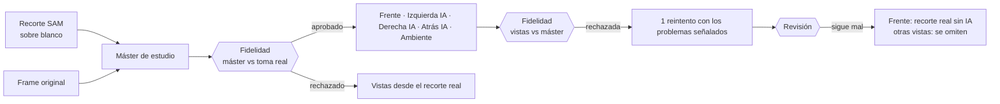

# Arquitectura de Brak Shop

Cómo funciona el pipeline video → catálogo por dentro, por qué está diseñado así y qué aprendimos usando la Meta Model API real.

- [Visión general](#visión-general)
- [Estado y sesiones](#estado-y-sesiones)
- [Fase 1 · Validación local](#fase-1--validación-local)
- [Fase 2 · Voz y productos](#fase-2--voz-y-productos)
- [Fase 3 · Visión y recorte](#fase-3--visión-y-recorte)
- [Fase 4 · Estudio fotográfico](#fase-4--estudio-fotográfico)
- [Fase 5 · Catálogo](#fase-5--catálogo)
- [Agentes verificadores](#agentes-verificadores)
- [Caché y auditoría de tokens](#caché-y-auditoría-de-tokens)
- [Robustez frente a la API](#robustez-frente-a-la-api)
- [Frontend](#frontend)
- [Lecciones aprendidas con la API real](#lecciones-aprendidas-con-la-api-real)

---

## Visión general

- Cada fase es una función `run_phaseN(session_id)` que lee el estado de la sesión, llama a los modelos y guarda el estado nuevo.
- `main.py` ejecuta cada fase **en otro hilo** (`asyncio.to_thread`), para que el servidor siga respondiendo, por ejemplo al progreso, mientras trabaja.
- El trabajo pesado de CPU (decodificar las máscaras de SAM) va en un **pool de procesos**. Si el pool no se puede crear, se sigue en secuencial.

## Estado y sesiones

- `storage/<session_id>/session_state.json` guarda todo lo que produce cada fase. Una copia de la última sesión se escribe en `session_state.json`, en la raíz del proyecto.
- Carpetas por sesión: `videos/`, `audio/`, `frames/`, `video_proxies/`, `collages/`, `bboxes/`, `cutouts/`, `studio/`, `catalog/` (`index` + `images/`).
- `storage/cache/` guarda las respuestas de la API por hash MD5 y se comparte entre sesiones.

| Clave del estado | La escribe | Contenido |
|---|---|---|
| `videos` | Fase 1 | Validación, calidad, audio 16 kHz y, desde la Fase 2, la transcripción |
| `semantic_products` | Fase 2 | Producto, precio, moneda, estado, tipo de mención y ventana de tiempo |
| `phase2_verification` | Fase 2 | Inventario visual, anomalías, decisiones del verificador |
| `grounded_products` | Fase 3 | Mejor frame, calidad, caja, recorte SAM y verificación del recorte |
| `studio_products` | Fase 4 | Máster, vistas, ambiente y controles de fidelidad (`studio_imagen`) |
| `catalog_products`, `catalog_store` | Fase 5 | Lo que consume la tienda: textos, categorías, vistas e imágenes |
| `token_audit` | Todas | Trazas del `TokenTracker` con tokens reales por llamada |

---

## Fase 1 · Validación local

**`backend/services/phase1_preprocess.py`** · 0 tokens

- Rechaza videos de más de 60 s, en negro o corruptos.
- Muestrea frames a 2 fps, mide su nitidez (varianza del Laplaciano) y su brillo, y rescata con CLAHE los que están levemente oscuros o borrosos.
- Extrae el audio en WAV mono a 16 kHz con FFmpeg. Si el video no tiene pista de audio, genera silencio para no cortar el flujo.

## Fase 2 · Voz y productos

**`phase2_semantic.py` + `muse_client.py` + `phase2_verify.py`**

1. **`muse-voice-transcribe-1.0`** en modo `ENDPOINTING`: devuelve **turnos** con `startMs`/`endMs`. No da tiempos por palabra.
2. **`muse-spark-1.3`**, en **1 sola llamada para todos los videos**, recibe:
   - cada video como `video_url` (una copia liviana a 480p y 1 fps, rotulada con su `video_id`);
   - las transcripciones por turnos;
   - un JSON Schema estricto que pide, por producto: la cita literal, `EXPLICIT` o `DEICTIC`, el nombre dicho y el visto, el precio y el precio corregido en vivo, la moneda, el estado y las características. También pide el **inventario visual**: todo objeto que el vendedor muestra a propósito.
3. **Ventana de tiempo:** se ubica la cita literal dentro del turno (coincidencia aproximada) y se interpola su posición a segundos (`QUOTE_ALIGNED_IN_TURN`), con ±1,5 s de margen.
4. **Verificador audio ↔ video** (ver [más abajo](#agentes-verificadores)).

## Fase 3 · Visión y recorte

**`phase3_vision_sam.py` + `phase3_verify.py`**

1. **Ventana de exhibición:** el intervalo del inventario visual que mejor coincide con el producto. Si no hay coincidencia, se usa la ventana hablada.
2. **3 candidatos:** el frame más nítido de cada tercio de la ventana, a resolución original.
3. **Collage 1×3** por producto, respetando la proporción del video. Una llamada a **Spark visión** por lote de hasta 8 productos devuelve:
   - el mejor frame;
   - el nombre comercial y la categoría;
   - la calidad (0–10) y si necesita mejora;
   - una caja;
   - de 2 a 4 frases en inglés para SAM.
4. **SAM 3.1** (`POST /responses`):
   - prueba las frases de Spark y acepta la máscara que coincide con su caja (IoU ≥ 0,3, o centro dentro de la caja);
   - **une las piezas** de un mismo producto, como un par de audífonos;
   - si ninguna frase coincide, usa la **caja como prompt**;
   - descarta máscaras con confianza menor a 0,3.
5. **Verificador de recortes:** revisa todos los recortes en una sola llamada y repara los que fallan.

## Fase 4 · Estudio fotográfico

**`phase4_studio.py`** · `muse-image-1.0` (`POST /images/edits`)

- **Máster para todos los productos:** completa **solo** lo que el encuadre cortó (se detecta midiendo si la caja toca el borde del frame) o lo que tapaba la mano. Nunca extiende el producto.
- **Prompts con el nombre del producto, sin la descripción de la escena.** Si la descripción decía "sostenido por una mano frente a una pared verde", el generador dibujaba la mano y la pared.
- **Toma insuficiente:** si la Fase 3 dejó un recorte rectangular o calidad < 4, **no se genera nada** y se muestra la foto real.
- **PNG maestro transparente:** `muse-image` siempre devuelve fondo opaco, así que se vuelve a pasar el máster por SAM 3.1.
- 6 imágenes en paralelo (`MUSE_IMAGE_PARALLEL`).

## Fase 5 · Catálogo

**`phase5_codegen.py`**

- **Spark redacta** título, descripción corta y larga, destacados, categoría (un conjunto coherente de máximo 6 categorías) y etiquetas, más el nombre y el lema de la tienda. Le está prohibido inventar medidas, materiales, autenticidad o garantías.
- **Una plantilla determinista** arma el HTML con filtros, buscador, vistas, ficha, carrito por moneda y "Consultar precio".
- **Imágenes optimizadas** (máx. 1024 px) en `catalog/images/` con rutas relativas. El ZIP se abre sin el servidor.

---

## Agentes verificadores

| Fase | Detecta (0 tokens) | Repara | Llamadas extra | Aplica cuando |
|---|---|---|---|---|
| 2 | Objeto mostrado sin oferta hablada; voz no transcrita (energía RMS); turno con pocas palabras; producto sin objeto visible | Re-transcribe solo ese tramo con pistas de vocabulario y le muestra a Spark un clip: agregar, corregir, sin cambios o descartar | 1 (solo si hay anomalías) | Confianza ≥ 0,7 |
| 3 | Spark revisa la hoja de recortes: OK, incompleto, objeto equivocado, contenido extra o irreconocible | SAM genera alternativas (parte faltante unida, caja ampliada, otros frames) y Spark elige o responde NONE (recorte rectangular) | 1 + 1 | Opción elegida, si cambia la máscara |
| 4 | Spark compara cada imagen con la referencia y con el frame original | 1 reintento con los problemas descritos en inglés | 2 + 2 como máximo | Si sigue mal: respaldo honesto |

**Reglas fijas que no dependen de la opinión de la IA**, agregadas tras errores observados:
- Una reparación que no cambia la máscara no cuenta como reparación.
- Las notas libres de un verificador no se pasan al generador de imágenes: una nota "le falta la parte de abajo" hizo que se inventaran piernas a un busto.
- Si la toma es insuficiente, no se genera nada con IA.

## Caché y auditoría de tokens

- **Clave MD5** = modelo + versión del prompt + parámetros + huella del contenido (audio, video, imagen o texto). Cambiar un prompt incrementa su versión e invalida solo esa caché.
- **Al leer de la caché** se usan los identificadores de la sesión actual: el mismo video puede volver en otra posición, por ejemplo `vid_3` cuando antes fue `vid_1`.
- **`TokenTracker`** registra cada evento con los tokens que reporta la API (`usage`), los ahorrados por caché (`CACHE_HIT_MD5`) y una traza `[MUSE-TRACE]`.
  - `muse-image` se cuenta por imagen (US$0.01).
  - SAM y Voice no reportan tokens.

## Robustez frente a la API

| Llamada | Espera inicial | Máximo |
|---|---|---|
| Spark | 90 s + 20 s por MB de la petición | 300 s |
| Muse Image | 120 s | 300 s |
| SAM 3.1 / Voice | 60 s | 180 s |

- **Si Meta no responde a tiempo,** el reintento **espera el doble**, con un máximo de 4 intentos. Los errores 429/5xx se reintentan con espera exponencial.
- **`progress.py` + `GET /api/v1/progress`** exponen el último evento, los avisos de espera y los contadores en vivo. El TokenTracker y el cliente de la API los alimentan.
- **Caracteres no imprimibles en la consola** de Windows (cp1252) se reemplazan en vez de detener el proceso.

## Frontend

`frontend/index.html`: HTML + Tailwind (CDN) + JavaScript sin compilación, con estética **Meta AI Dark Studio**.

- **Datos:** une `catalog_products` (Fase 5) con `studio_products` (mejor frame, calidad, tipo de mención, recorte SAM).
- **Imágenes del catálogo:** `/storage/<sesión>/catalog/<src>`. Las demás usan rutas `/storage/...`.
- **Base de la API configurable** con `localStorage.brak_api_base`. Si está vacía, usa el mismo origen.
- **Persistencia** en `localStorage`: `brak_approved_v1`, `brak_pending_v1`, `brak_cart_v1`.

---

## Lecciones aprendidas con la API real

1. **El audio no llega a Spark como `input_audio`** (se descarta en silencio), **pero `video_url` sí funciona.** Por eso Spark recibe el video y la voz pasa por Voice Transcribe.
2. **`reasoning_effort: "low"`** dio el mismo resultado que el valor por defecto con **~54 % menos tokens de salida**.
3. **Spark devuelve las cajas en coordenadas del collage completo,** aunque se le pidan relativas al panel. El código las convierte usando la posición de cada panel.
4. **SAM entiende mejor sustantivos genéricos:** "bottle" funciona y "spray bottle" no. Por eso se prueban de 2 a 4 frases, de la más específica a la más genérica.
5. **El parser oficial de SAM decodifica las máscaras en Python puro** (1–6 s cada una). Un pool de procesos bajó la Fase 3 con 15 productos de ~8,5 min a ~1 min (desde la caché).
6. **`muse-image` copia lo que dice el prompt:** si el nombre menciona "con paño de microfibra", dibuja un paño. Si la descripción menciona una mano, dibuja una mano.
7. **Nombres de marcas o personajes** (Winnie the Pooh, Iron Man, Funko) provocan `content_policy_violation`. Reintentar sin el nombre funciona.
8. **Una petición puede quedarse colgada en Meta** mientras la API responde normal a otras. Se observó con Spark visión: 5 min sin respuesta, y el reintento respondió en 13 s. De ahí las esperas según el tamaño de la llamada.
9. **Los verificadores también son IA.** Detectan y corrigen mucho, pero pueden aprobar errores o rechazar aciertos. Las reglas fijas y la bandeja de **Pendientes** cubren esos casos.
